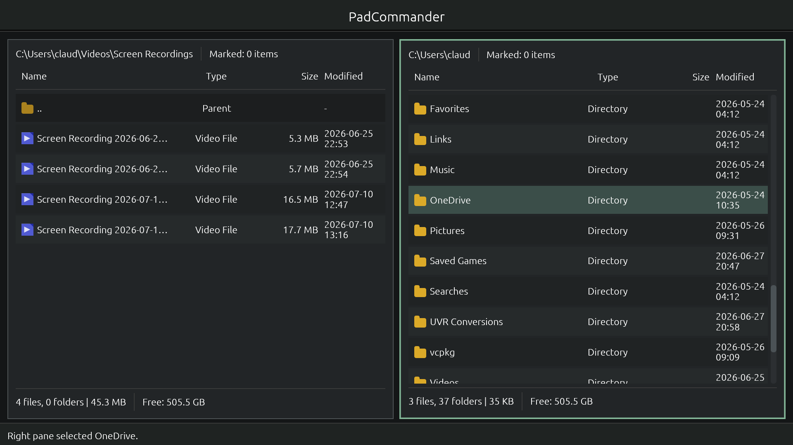
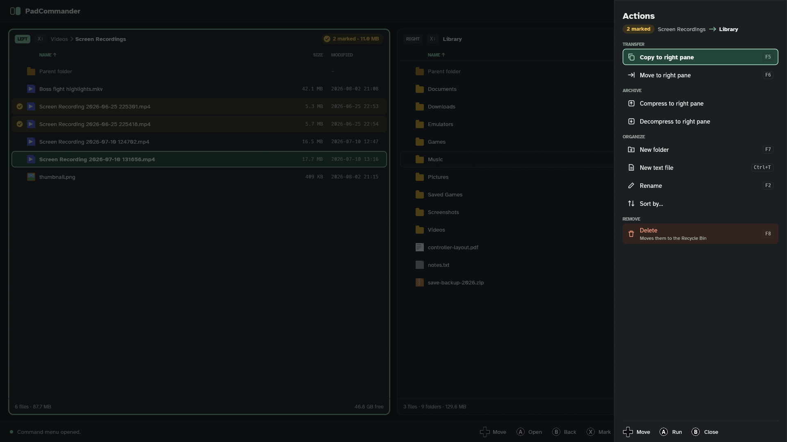
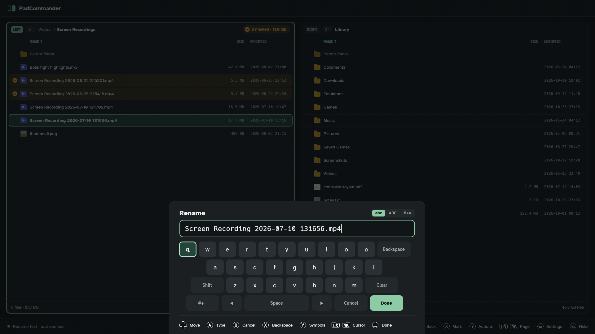

# PadCommander

<!-- Logo placeholder -->
<!-- <p align="center">
  
</p> -->

<p align="center">
  <strong>A gamepad-first dual-pane file manager for Windows and Linux</strong>
</p>

<p align="center">
  
  
</p>

---

PadCommander is a full-screen, gamepad-first two-pane file manager for Windows and Linux (including Steam Deck), inspired by Total Commander and Double Commander. Navigate your files with an Xbox, PlayStation, or Nintendo Switch controller — or stick to the keyboard if you prefer.

<p align="center">
  
  <br/>
  <em>Dual-pane navigation with gamepad input</em>
</p>
<p align="center">
  
  <br/>
  <em>Actions menu for copying, moving, archiving and organizing marked files</em>
</p>
<p align="center">
  
  <br/>
  <em>Built-in on-screen keyboard for controller-driven text entry</em>
</p>

## Features

- **Dual-pane commander layout** — browse two directories side by side
- **Gamepad as first-class input** — full navigation and file operations from a controller
- **On-screen keyboard** — enter filenames and paths without touching a keyboard
- **File operations** — copy, move, delete, compress, and decompress archives
- **Controller auto-detection** — supports Xbox, PlayStation 4/5, and Nintendo Switch controllers
- **Theme support** — Dark and Light modes
- **Configurable UI scale** — adjust the interface scale to suit your display

## Requirements

- Windows 10 or later, or Linux (x86_64, X11 or Wayland; Steam Deck supported)
- Rust 1.85+
- Windows: MSVC C++ Build Tools
- Linux: see [docs/BUILD_LINUX.md](docs/BUILD_LINUX.md) for the system packages

## Building from Source

```powershell
# Debug build
cargo build

# Run directly
cargo run

# Optimized release build
cargo build --release
```

The release binary is output to `target\release\pad-commander.exe` on Windows and `target/release/pad-commander` on Linux.

## Usage

Launch the application and use your gamepad or keyboard to navigate. The two panes work independently — switch between them to copy or move files across directories.

### Gamepad Controls

| Action | Button |
|---|---|
| Navigate | Left stick / D-pad |
| Confirm / Open | A (Xbox) / Cross (PS) |
| Back / Up a directory | B (Xbox) / Circle (PS) |
| Switch pane | Left / Right bumper |
| File operations menu | Y (Xbox) / Triangle (PS) |
| On-screen keyboard | X (Xbox) / Square (PS) |

### Keyboard Controls

| Action | Key |
|---|---|
| Navigate | Arrow keys |
| Confirm / Open | Enter |
| Back | Backspace |
| Switch pane | Tab |
| Copy | F5 |
| Move | F6 |
| Delete | F8 |

## Configuration

Settings are saved automatically and persist between sessions. You can configure:

- **Theme** — Dark or Light
- **UI Scale** — adjust interface size (minimum 0.5×)
- **Controller type** — auto-detect or force a specific controller layout (Xbox, PS4/5, Switch)

## Tech Stack

| Component | Library |
|---|---|
| GUI | [egui](https://github.com/emilk/egui) / [eframe](https://github.com/emilk/egui/tree/master/crates/eframe) |
| Gamepad input | [gilrs](https://gitlab.com/gilrs-project/gilrs) |
| Archive support | zip, unarc-rs |
| Platform APIs | windows, windows-sys (Windows); libc, trash (Linux) |
| Serialization | serde / serde_json |

## License

[MIT](LICENSE)

---

<p align="center">
  <a href="https://ko-fi.com/claudiopereira">☕ Support this project on Ko-fi</a>
</p>
